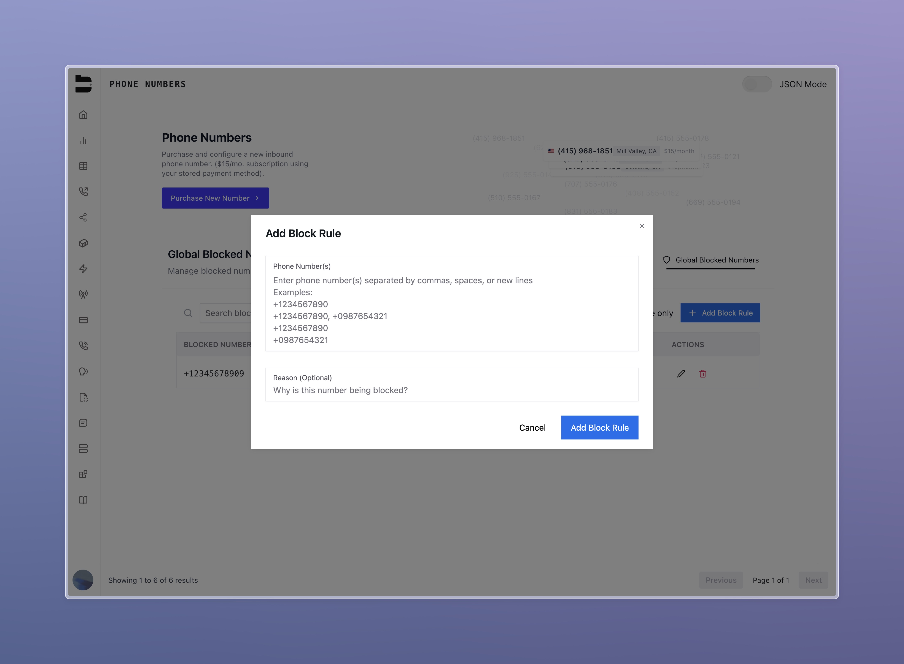

## Overview

The **Blocked Numbers** feature allows you to prevent specific phone numbers from reaching your Bland inbound lines. A block rule applies in one of two ways:

* **Individually**: Block a number for a specific inbound number only
* **Globally**: Block a number across all your inbound numbers

---

## Individual Number Block Rules

You manage block rules for a single inbound number from that number's configuration in [Dispatch](/agents/dispatch#configure-a-number).

1. Use the selector at the top of the sidebar to switch to **All agents**
2. Under Dispatch, open **Phone numbers**
3. Press **Configure** on the number's row
4. Open **Blocked numbers**, under **Call screening**

Here, you can configure block rules that apply **only** to the selected number.

---

## Global Number Block Rules

A global block rule rejects a phone number regardless of which of your inbound numbers it calls. To create one, send `is_global: true` to the [Create Block Rules](/api-v1/post/blocked-numbers) endpoint.

---

## Block Rule Fields

Each block rule in the table includes the following columns:

* **Blocked Number**: The E.164 formatted phone number that is blocked
* **Type**: `global` or `specific`, depending on whether it applies to all numbers or just one
* **Reason**: Optional text indicating why this number was blocked
* **Status**: Indicates if the rule is currently active; can be toggled without deleting
* **Created**: Date the rule was originally added
* **Actions**: Options to edit or delete the rule

---

## Adding Block Rules

When adding new block rules, you can paste or enter numbers in bulk using:

* Comma-separated values (CSV)
* Space-separated values
* New line-separated values

You may also optionally include a reason for blocking the number(s).

---

## Editing Block Rules

Block rules can be edited after creation to:

* Update the **reason**
* Toggle **status** active or inactive

> Note: Once a block rule is created, the phone number itself becomes immutable. You cannot modify or replace it. Only the reason and status can be changed.

---

## API Access

You can programmatically manage blocked numbers using our API. 

[View the Blocked Numbers API Documentation](/api-v1/post/blocked-numbers)

---

Docs for agents: [llms.txt](/llms.txt)
