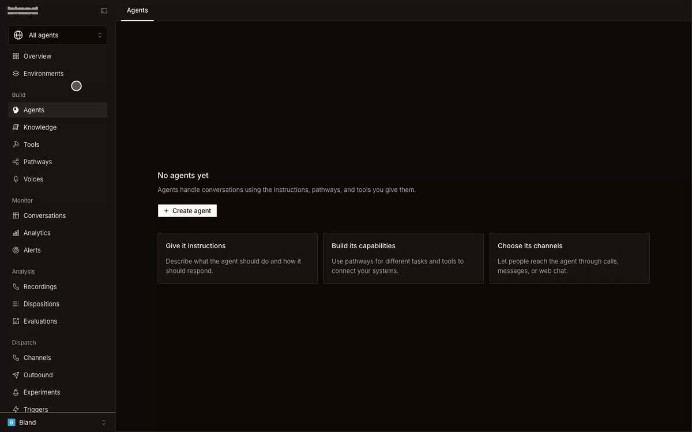
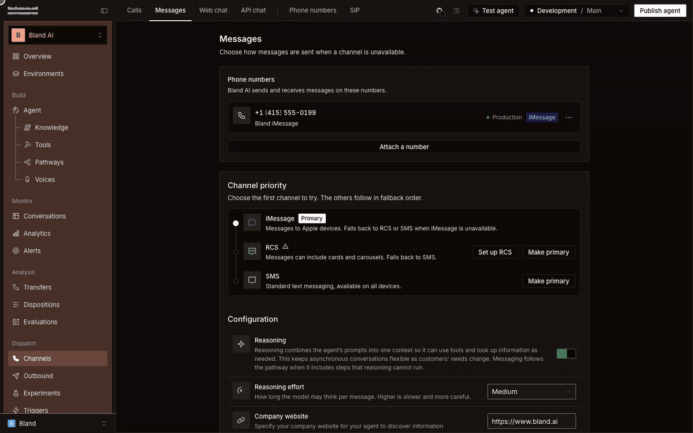
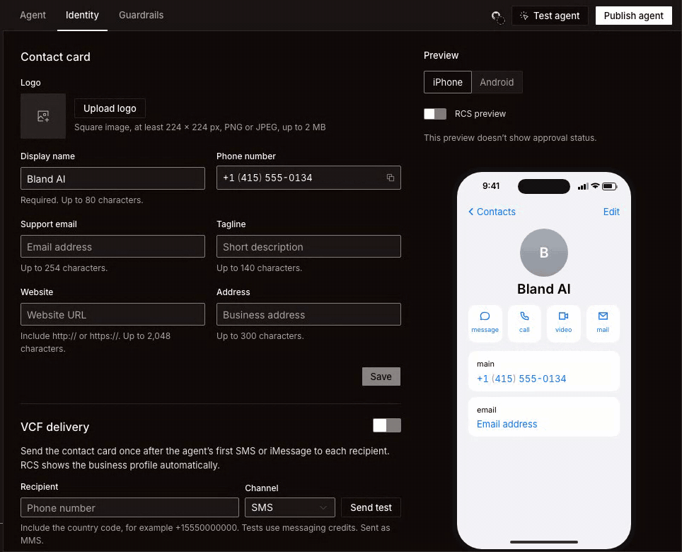
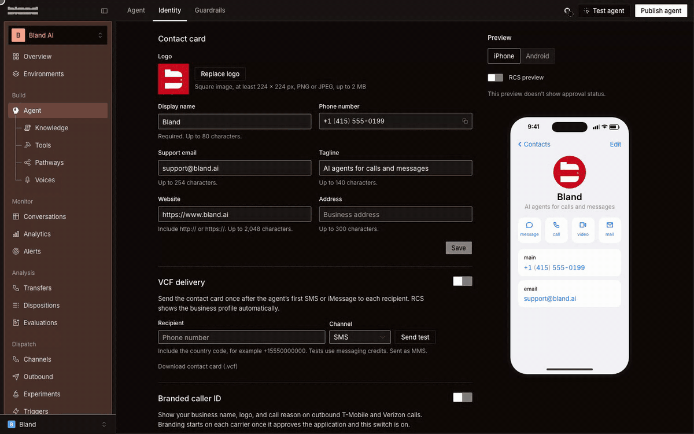

Contact in your phone is an agent your customers save as a contact. It appears in their messaging app with your company name and logo, and it replies when they text it.

This guide builds one from start to finish. The example is Bland's own agent, built from bland.ai in a new workspace. Every step works the same for your company.

<Info>
  **Enterprise feature.** iMessage and RCS are available on Enterprise plans. Contact your Account Executive or [reach out to sales](https://www.bland.ai/book-a-demo) to get set up.
</Info>

## Why it matters

Customers ignore texts from numbers they do not recognize, and most will not install an app to ask one question. A contact they have saved gets opened.

Take a clinic. A patient saves the clinic's contact once. From then on they text it to move an appointment, send a photo of an insurance card, or ask what a charge was for. The replies come from the clinic's name and logo, in the same thread each time, and nobody waits on hold.

Three things make that work:

- **Your brand is on every message.** The contact card carries your logo and name. On RCS the business profile is verified, so the customer can check who is texting before they reply.
- **It uses the messaging app the customer already has.** There is no app to install and no account to create.
- **It is the same agent that answers your phone line.** Instructions, tools, and [memory](/tutorials/memories) are shared, so a customer who called last week does not start over by text.

## How it fits together

You build one agent, then decide how it appears and where it can be reached.

| Piece | Where you set it | What the customer sees |
|---|---|---|
| Contact card | **Identity**, inside the agent | Your logo, name, tagline, email, and website on the saved contact |
| iMessage | Set up by Bland support | Blue bubbles, tapbacks, photos, files, and voice memos on Apple devices |
| RCS contact card | **Identity**, submitted from the dashboard | A verified business profile with your name, logo, and colors on Android |
| SMS | **Channels**, inside the agent | Plain text on every phone, as the fallback |

In the dashboard this feature is called **Identity**. You will not find a page named Contact in your phone.

## Prerequisites

- An Enterprise workspace on the new dashboard at [v2.app.bland.ai](https://v2.app.bland.ai)
- Your company website, or a prompt you already use
- A square logo, at least 224 x 224 px, PNG or JPEG, up to 2 MB
- For RCS: your legal entity name, business address, privacy policy URL, and terms of service URL

## Build the agent

<Steps>
  <Step title="Create the agent from your website">
    Open **Agents** and click **Create agent**. Choose **Create from website**, enter your company website, and click **Create agent**.

    Bland reads your site and writes the agent for you. It takes 1 to 2 minutes. Messages use your site as a source, and calls follow the same instructions.

    

    You can also start from **Create blank agent** and write the prompt yourself, or use **Migrate** to bring over a pathway or persona. See [Agent builder](/agents/agent-builder).
  </Step>

  <Step title="Attach a number">
    Inside the agent, open **Channels** under Dispatch and click the **Messages** tab. Click **Attach a number**, pick a number, and click **Attach number**.

    Once a number is attached, **Channel priority** appears. It lists iMessage, RCS, and SMS in the order the agent tries them. The first channel is marked **Primary**, and the others follow as fallbacks. Click **Make primary** on a row to change the order. In the recording below, iMessage is not available yet because the number is not set up for it.

    

    The picker lists numbers that are not assigned to another agent. To buy a number first, see [Dispatch](/agents/dispatch#put-an-agent-on-a-phone-number).
  </Step>

  <Step title="Fill in the contact card">
    Open **Agent** in the sidebar and click the **Identity** tab. The **Contact card** section is what customers see when they save your agent. **Phone number** is filled in from the number you attached.

    | Field | Limit |
    |---|---|
    | **Logo** | Square image, at least 224 x 224 px, PNG or JPEG, up to 2 MB |
    | **Display name** | Required. Up to 80 characters |
    | **Support email** | Up to 254 characters |
    | **Tagline** | Up to 140 characters |
    | **Website** | Include `http://` or `https://`. Up to 2,048 characters |
    | **Address** | Up to 300 characters |

    The **Preview** on the right updates as you type. Switch between **iPhone** and **Android** to check both. Click **Save** when it looks right.

    

    <Note>
    Identity has its own **Save**. It is separate from saving and publishing the agent, so a change to the contact card does not need a new version.
    </Note>
  </Step>

  <Step title="Send the contact card automatically">
    Still on **Identity**, turn on **VCF delivery**. Your agent then sends the contact card once, after its first SMS or iMessage to each person. The customer taps it and saves you.

    RCS does not need this. It shows your business profile on its own.

    To see what a customer receives, enter your own number under **Recipient**, choose a **Channel**, and click **Send test**. Include the country code, for example `+15550000000`. Tests use messaging credits, and an SMS test is sent as MMS. **Download contact card (.vcf)** gives you the same file to share anywhere else, such as an email signature or a QR code.
  </Step>

  <Step title="Publish the agent">
    Attaching a number does not publish your agent. Click **Publish agent** and promote it to production so customers reach the version you just built. See [Publish and promote](/agents/agent-builder#publish-and-promote).
  </Step>
</Steps>

## Turn on each channel

### iMessage

iMessage needs a number that Bland sets up for it. You cannot turn it on yourself from the dashboard. Until you have one, the iMessage row under **Channel priority** reads "Requires an iMessage-capable number".

To get one, contact Bland support. Click your organization's name at the bottom of the sidebar, then **Contact support**, or email [support@bland.ai](mailto:support@bland.ai). Tell us which agent the number is for.

When the number is on your account, attach it the same way as any other. iMessage becomes available in **Channel priority**, and messages fall back to RCS or SMS when the customer is not on an Apple device.

For what your agent can do over iMessage, see [iMessage](/tutorials/messaging/imessage).

### RCS

You submit RCS yourself, from the dashboard. On **Identity**, find **RCS contact card** and click **Set up RCS contact card**. You can also get there from **Set up RCS** in **Channel priority**. The agent needs a number attached first.

The setup has six steps:

| Step | What you provide |
|---|---|
| **Branding** | Sender display name, accent color, and description. The logo comes from your contact card |
| **Business identity** | Legal entity name, business address, privacy policy URL, and terms of service URL |
| **Contact details** | Phone, email, website, use case, and destination country |
| **Test devices** | Phone numbers that can receive RCS from your agent before approval |
| **Compliance** | Google registration for every sender, plus US registration when you message US numbers |
| **Submit for review** | A checklist of what is done, and **Submit for review** |

<Warning>
Submitting for review permanently locks the branding fields. Check the display name, color, description, and logo before you submit. The use case cannot be changed after the sender is created either.
</Warning>

Approval takes about a week. The status on the **RCS contact card** section moves from Draft to In review, then Pending verification, then Online. Once it is Online, attach it to messaging from the last step and your agent starts sending RCS.

While you wait, add your own phone under **Test devices** and accept the invitation on that phone. You can then text the agent over RCS and see the real profile.

Turning the **RCS contact card** switch off sends plain SMS instead.

### SMS

SMS is the fallback that reaches every phone. To send SMS to US numbers, the number needs A2P 10DLC registration. Receiving works without it. Start from the SMS row in **Channel priority**, and see [SMS](/tutorials/messaging/sms) for the details.

## Check it before you share it

1. Send yourself a test from **VCF delivery** on each channel you turned on.
2. Save the contact on your phone and confirm the name, logo, and tagline.
3. Text the agent a real question and read the reply.
4. Open [Conversations](/agents/conversations) and confirm the thread is listed under your agent.

## Common questions

<AccordionGroup>
  <Accordion title="I don't see Identity or Messages">
    Both need messaging on your plan. iMessage and RCS are Enterprise only. If your workspace should have them, contact support.
  </Accordion>

  <Accordion title="The Phone number field on the contact card is empty">
    It shows the number attached to the agent and cannot be edited. Attach a number in **Channels** and it fills in.
  </Accordion>

  <Accordion title="Send test and Set up RCS contact card are disabled">
    Both need a number on the agent. Attach one in **Channels** first.
  </Accordion>

  <Accordion title="Can the same agent answer calls too?">
    Yes. A number attached to the agent reaches it for calls and messages. The **Identity** page also has **Branded caller ID**, which shows your business name and logo on outbound T-Mobile and Verizon calls once the carriers approve it.
  </Accordion>

  <Accordion title="A customer has an Android phone. What do they see?">
    Your verified RCS profile once RCS is Online. Before that, or on a phone without RCS, they get SMS, with the contact card sent once if **VCF delivery** is on.
  </Accordion>
</AccordionGroup>

## Next steps

<CardGroup cols={2}>
  <Card title="iMessage" icon="comment" href="/tutorials/messaging/imessage">
    Photos, files, voice memos, and tapbacks.
  </Card>
  <Card title="RCS" icon="message-dots" href="/tutorials/messaging/rcs">
    Verified profile, suggested replies, and cards.
  </Card>
  <Card title="Dispatch" icon="tower-broadcast" href="/agents/dispatch">
    Numbers, channels, and per-number messaging settings.
  </Card>
  <Card title="Memory" icon="brain" href="/tutorials/memories">
    Let the agent remember each customer across calls and texts.
  </Card>
</CardGroup>

---

Docs for agents: [llms.txt](/llms.txt)
